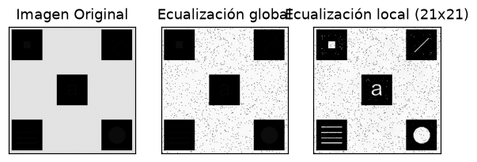
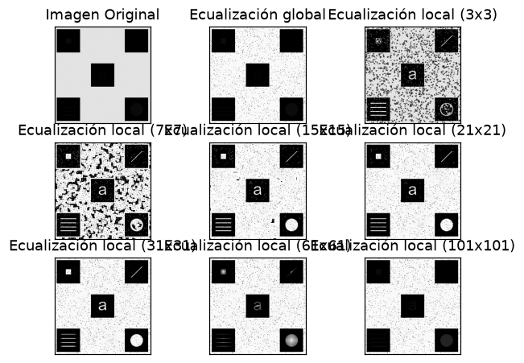

# Local histogram equalization and grade sheet validation

Group project by four team members. Image Processing I, University Technical Degree in Artificial Intelligence (FCEIA, UNR, Argentina), second semester of 2026. Group 8.

[Versión en español](README.md)

We solved two problems with OpenCV and NumPy. In the first one we implemented local histogram equalization and used it to reveal five details hidden in an image. In the second one we automatically validated four scanned grade sheets: the script reports which fields meet the rules, builds an image with the students who did not pass and saves one CSV per sheet.

## Team

This is a group project by four people:

- Valentino Civetta
- Maximiliano Frank
- Milagros Fucci
- Federico Winter

Original group repository: [valentinocivetta04/Procesamiento_Imagenes_Grupo8](https://github.com/valentinocivetta04/Procesamiento_Imagenes_Grupo8).

This repository is a copy under Maximiliano Frank's account, reorganized to show as a portfolio piece. The group owns the work. We worked together in Discord meetings, and whoever shared their screen made the commits. The git history therefore does not show who solved each part.

## Problem 1: local histogram equalization

The `ecualizacion_local(img, M, N)` function walks the image pixel by pixel. For each pixel it takes an M x N window, applies `cv2.equalizeHist` and keeps only the central value. Borders are padded by replicating the edge pixels.

Applied to `Imagen_con_detalles_escondidos.tif` (256 x 256, 8 bits), local equalization shows what global equalization does not. A detail appears inside each of the five dark squares:

| Zone | Detail |
|---|---|
| Top left | A small square |
| Top right | A diagonal line |
| Center | A lowercase "a" |
| Bottom left | Four parallel horizontal lines |
| Bottom right | A circle |



*Original image, global equalization and local equalization with a 21 x 21 window.*

We compared square and rectangular windows. With 15 x 15 and 21 x 21 all five details appear in full and the background stays almost clean. With 3 x 3 and 7 x 7 the background fills with blotches. With 61 x 61 and 101 x 101 the details fade, because the window side gets close to the side of the squares (62 pixels) or exceeds it. We chose 21 x 21 because it leaves fewer black marks in the background.



*Effect of the square window size (the script also shows the rectangular windows).*

The figures are labeled in Spanish, as in the scripts.

## Problem 2: grade sheet validation

Each sheet is an image with a table of 20 records. The script:

1. Finds the table lines with row and column sums (22 horizontal and 8 vertical lines in all four sheets) and crops each cell.
2. Counts the characters in each cell with connected components.
3. Splits words with a 6-pixel threshold between characters.
4. Validates each field with a rule on the number of characters and words: ID number (Legajo), Name and surname, Exam 1, Exam 2, Exam 3 and Final status.
5. Tells the letters L, R and A in the Final status apart by shape: L and R have a filled left column, and R has a hole.
6. Writes `no_aprobados_grade_sheet_<id>.png` with the students whose status is L or R, and `validacion_grade_sheet_<id>.csv` with the OK or MAL of each field.

Results for the four sheets, as the script prints them:

| Sheet | Correct records | Not passed (R / L) |
|---|---|---|
| `grade_sheet_1.png` | 15 of 20 | 4 / 6 |
| `grade_sheet_2.png` | 3 of 20 | 0 / 3 |
| `grade_sheet_3.png` | 0 of 20 | 0 / 0 |
| `grade_sheet_4.png` | 6 of 20 | 2 / 2 |

A record is correct only if its six fields meet the rules. Empty rows count as MAL. Only correct records enter the not-passed image, so sheet 3 has no students in it.

## Technologies

Run with Python 3.13.16.

| Library | Version | Use |
|---|---|---|
| numpy | 2.5.3 | Arrays, row and column sums |
| opencv-python | 5.0.0.93 | Equalization, connected components, contours |
| matplotlib | 3.11.2 | Problem 1 figures |

`requirements.txt` does not pin versions. With it, `pip` installs the latest ones.

## Repository structure

```
problema1.py                              local equalization and hidden details
problema2.py                              sheet validation, not-passed image and CSV
data/                                     Problem 1 image and Problem 2 sheets
assets/                                   figures exported from Problem 1
docs/Informe_TP1_PDI_Grupo8.pdf           full group report (in Spanish)
requirements.txt                          dependencies
README.md                                 Spanish README
README.en.md                              this file
```

## How to run it

Run the scripts from the repository root.

```bash
git clone https://github.com/MaxiFrank7/histogram-equalization-grade-sheets.git
cd histogram-equalization-grade-sheets
python3 -m venv .venv
source .venv/bin/activate
pip install -r requirements.txt
python problema1.py
python problema2.py
```

On Windows, the activation command is `.venv\Scripts\activate`.

- `problema1.py` prints the list of hidden details and opens four matplotlib windows. It saves no files. It takes about 4 seconds. Without a display, prepend `MPLBACKEND=Agg`.
- `problema2.py` processes the four sheets, prints the status of each field and a summary, and writes `no_aprobados_*.png` and `validacion_*.csv` into `data/`. Those output files are in `.gitignore`.

The text in the scripts and figures is in Spanish.

## Report

The analysis of each problem, the techniques and the conclusions are in the [group report](docs/Informe_TP1_PDI_Grupo8.pdf), written in Spanish.

## Limitations

- Local equalization amplifies noise. In the light background, the pixels with level 226 in the original image turn dark. They are 2.5 % of the background.
- The script does not measure contrast or noise per window. We chose 21 x 21 by looking at the figures.
- The positions of the squares in Problem 1 are hardcoded in the `ZONAS` table. The script does not find zones in another image.
- In Problem 2 the script does not read characters. It counts connected components, measures gaps and compares the shape of three letters.
- We tuned the thresholds with these four sheets. With another typeface or scale they could fail.
- The name rule counts letters only. A space is not a connected component, so it does not add up. This was our decision, because the assignment does not say whether the space counts.
