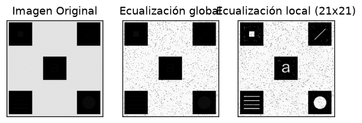
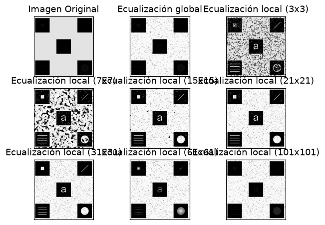

# Ecualización local de histograma y validación de planillas

Trabajo práctico grupal de cuatro integrantes. Procesamiento de Imágenes I, Tecnicatura Universitaria en Inteligencia Artificial (FCEIA, UNR), segundo cuatrimestre de 2026. Grupo 8.

[English version](README.en.md)

Resolvimos dos problemas con OpenCV y NumPy. En el primero implementamos la ecualización local de histograma y la usamos para revelar cinco detalles escondidos en una imagen. En el segundo validamos de forma automática cuatro planillas de calificaciones escaneadas: el script informa qué campos cumplen las reglas, arma una imagen con los alumnos que no aprobaron y guarda un CSV por planilla.

## Equipo

Este es un trabajo grupal de cuatro personas:

- Valentino Civetta
- Maximiliano Frank
- Milagros Fucci
- Federico Winter

Repositorio original del grupo: [valentinocivetta04/Procesamiento_Imagenes_Grupo8](https://github.com/valentinocivetta04/Procesamiento_Imagenes_Grupo8).

Este repositorio es una copia en la cuenta de Maximiliano Frank, reorganizada para mostrarla como portfolio. La autoría es del grupo. Trabajamos juntos en reuniones por Discord, y quien compartía pantalla hacía los commits. Por eso el historial de git no refleja quién resolvió cada parte.

## Problema 1: ecualización local de histograma

La función `ecualizacion_local(img, M, N)` recorre la imagen píxel a píxel. Para cada píxel toma una ventana de M x N, le aplica `cv2.equalizeHist` y conserva solo el valor central. Los bordes se completan replicando los píxeles del contorno.

Aplicada a `Imagen_con_detalles_escondidos.tif` (256 x 256, 8 bits), la ecualización local muestra lo que la global no muestra. En cada uno de los cinco cuadrados oscuros aparece un detalle:

| Zona | Detalle |
|---|---|
| Superior izquierda | Un cuadrado pequeño |
| Superior derecha | Una línea diagonal |
| Centro | La letra "a" minúscula |
| Inferior izquierda | Cuatro líneas horizontales paralelas |
| Inferior derecha | Un círculo |



*Imagen original, ecualización global y ecualización local con ventana de 21 x 21.*

Comparamos ventanas cuadradas y rectangulares. Con 15 x 15 y 21 x 21 aparecen los cinco detalles completos y el fondo queda casi limpio. Con 3 x 3 y 7 x 7 el fondo se llena de manchas. Con 61 x 61 y 101 x 101 los detalles se apagan, porque el lado de la ventana se acerca al de los cuadrados (62 píxeles) o lo supera. Elegimos 21 x 21 porque deja menos marcas negras en el fondo.



*Efecto del tamaño de la ventana cuadrada (el script también muestra las ventanas rectangulares).*

## Problema 2: validación de planillas

Cada planilla es una imagen con una tabla de 20 registros. El script:

1. Encuentra las líneas de la tabla con las sumas por fila y por columna (22 horizontales y 8 verticales en las cuatro planillas) y recorta cada celda.
2. Cuenta los caracteres de cada celda con componentes conectadas.
3. Separa las palabras con un umbral de 6 píxeles entre caracteres.
4. Valida cada campo con una regla de cantidad de caracteres y de palabras: Legajo, Nombre y apellido, Parcial 1, Parcial 2, Parcial 3 y Condición Final.
5. Distingue las letras L, R y A de la Condición Final por su forma: la L y la R tienen la columna izquierda llena y la R tiene un agujero.
6. Genera `no_aprobados_grade_sheet_<id>.png` con los alumnos en condición L o R y `validacion_grade_sheet_<id>.csv` con el OK o MAL de cada campo.

Resultados de las cuatro planillas, tal como los imprime el script:

| Planilla | Registros correctos | No aprobados (R / L) |
|---|---|---|
| `grade_sheet_1.png` | 15 de 20 | 4 / 6 |
| `grade_sheet_2.png` | 3 de 20 | 0 / 3 |
| `grade_sheet_3.png` | 0 de 20 | 0 / 0 |
| `grade_sheet_4.png` | 6 de 20 | 2 / 2 |

Un registro es correcto solo si sus seis campos cumplen las reglas. Las filas vacías cuentan como MAL. Solo los registros correctos entran en la imagen de no aprobados, por eso la planilla 3 no tiene alumnos en ella.

## Tecnologías

Ejecutado con Python 3.13.16.

| Librería | Versión | Uso |
|---|---|---|
| numpy | 2.5.3 | Arrays, sumas por filas y columnas |
| opencv-python | 5.0.0.93 | Ecualización, componentes conectadas, contornos |
| matplotlib | 3.11.2 | Figuras del Problema 1 |

El archivo `requirements.txt` no fija versiones. Con él, `pip` instala las más recientes.

## Estructura del repositorio

```
problema1.py                              ecualización local y detalles ocultos
problema2.py                              validación de planillas, imagen de no aprobados y CSV
data/                                     imagen del Problema 1 y planillas del Problema 2
assets/                                   figuras exportadas del Problema 1
docs/Informe_TP1_PDI_Grupo8.pdf           informe completo del grupo
requirements.txt                          dependencias
README.md                                 este archivo
README.en.md                              versión en inglés
```

## Cómo ejecutarlo

Hay que ejecutar los scripts desde la raíz del repositorio.

```bash
git clone https://github.com/MaxiFrank7/histogram-equalization-grade-sheets.git
cd histogram-equalization-grade-sheets
python3 -m venv .venv
source .venv/bin/activate
pip install -r requirements.txt
python problema1.py
python problema2.py
```

En Windows, la activación del entorno es `.venv\Scripts\activate`.

- `problema1.py` imprime la lista de detalles ocultos y abre cuatro ventanas de matplotlib. No guarda archivos. Tarda unos 4 segundos. Sin pantalla, se puede anteponer `MPLBACKEND=Agg`.
- `problema2.py` procesa las cuatro planillas, imprime el estado de cada campo y un resumen, y escribe en `data/` los archivos `no_aprobados_*.png` y `validacion_*.csv`. Esos archivos de salida están en `.gitignore`.

El texto de los scripts y de las figuras está en español.

## Informe

El análisis de cada problema, las técnicas usadas y las conclusiones están en el [informe del grupo](docs/Informe_TP1_PDI_Grupo8.pdf).

## Limitaciones

- La ecualización local amplifica el ruido. En el fondo claro quedan oscuros los píxeles de nivel 226 de la imagen original, que son el 2,5 % del fondo.
- El script no mide contraste ni ruido por ventana. Elegimos 21 x 21 mirando las figuras.
- Las posiciones de los cuadrados del Problema 1 están escritas a mano en la tabla `ZONAS`. El script no encuentra zonas en otra imagen.
- En el Problema 2 el script no lee caracteres. Cuenta componentes conectadas, mide separaciones y compara la forma de tres letras.
- Ajustamos los umbrales con estas cuatro planillas. Con otra tipografía u otra escala podrían fallar.
- La regla del nombre cuenta solo letras. El espacio no es una componente conectada, así que no suma. Es una decisión nuestra, porque la consigna no aclara si el espacio cuenta.
